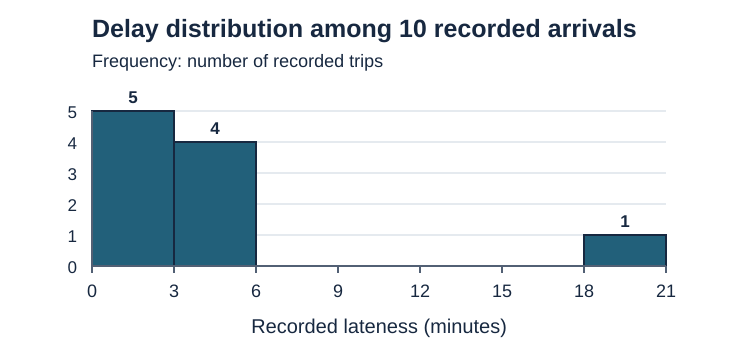

# Chapter 2 — Summarize without hiding variation

*Center is not spread, and neither tells the whole story.*

Suppose another run supplies ten observed lateness measurements in minutes, sorted for checking: `0, 1, 1, 2, 2, 3, 4, 4, 5, 18`. This is a separate fictional fixture, not the trip table in Chapter 1. A dashboard displays “4 minutes.” Does 4 describe what a typical trip did, what counts toward a total cost, or how much tail risk matters? A delay of 18 is unusual in these observations; from the data alone you cannot decide whether it is a sensor mistake or the event a rider most needs you to see.

By the end, compute and interpret center and spread, verify one plotted bin independently, quantify an outlier sensitivity check, and communicate what a summary hides.

## Start with an inventory of values

A histogram groups numeric values into adjoining intervals. State the bin edges and membership convention. Here each bin includes its left edge and excludes its right edge, including the final bin. The 3 goes in $[3,6)$, not $[0,3)$. The 18 goes in $[18,21)$, not $[15,18)$. Gaps of zero observations are still drawn as intervals. Heights are counts with equal widths: width three minutes throughout. If widths differ, count density (count divided by width) makes area represent counts; heights alone would no longer describe comparable counts.

| Bin, minutes | $[0,3)$ | $[3,6)$ | $[6,9)$ | $[9,12)$ | $[12,15)$ | $[15,18)$ | $[18,21)$ |
| --- | ---: | ---: | ---: | ---: | ---: | ---: | ---: |
| Count | 5 | 4 | 0 | 0 | 0 | 0 | 1 |

Read the input independently. Entries 0,1,1,2,2 make five in the first bin. Entries 3,4,4,5 make four in the second. The counts sum to ten. Those two checks catch different errors: a total can still look right after moving a value into the wrong bin. The bars show counts, not a model of the underlying distribution. The bin choice hides what changed *inside* an interval. A different reasonable width can reveal or hide a cluster, particularly with only ten values. For so few observations a dot plot or list is a useful companion. The [NIST handbook's exploratory data analysis chapter](https://itl.nist.gov/div898/handbook/eda/eda.htm) discusses graphical checks in that broader setting.

## Take apart the one number

The sample mean divides the sum of the values by the number observed. Their sum is 40, so the mean is 4 minutes. It preserves the total if the sample size is retained: ten times the mean restores 40. The median is the midpoint of the two central values in an even-length sorted list. The fifth and sixth are 2 and 3, so the median is 2.5 minutes. This is a rank-based center, not the per-trip contribution to the aggregate sum.

Here is a sensitivity calculation, not permission to replace a genuine observation. If the last value had been 8 rather than 18, the sum would be 30 and mean 3. The median would stay 2.5. The change in one value is 10 minutes and one tenth of that change moves the mean. The median can also change when which values occupy the middle shifts; resistance is not immunity. Reporting only the median can hide the practical harm of a missed connection. Reporting only the mean can hide how rarely a time near that mean occurred. A comparison that chooses the median only after seeing the inconvenient mean also needs explanation.

A measure of spread should name which variation it cares about. For an interquartile range, use an explicit quartile convention. In this manuscript split the ordered observations into lower and upper halves, discarding the lone overall median if the sample size is odd; then find each half's median. The first and third quartiles here are 1 and 4, so the IQR is 3 minutes. Other reasonable quantile definitions used by spreadsheets and packages can differ on small samples. Specify which you used. The range is $18-0=18$ minutes, or 8 in the changed case; the IQR remains 3. Both are the answer to a different question.

For sample standard deviation, first subtract the mean from each reading. The unsquared deviations sum to zero; left and right deviations cancel. Square and sum them to get squared-deviation total 240. Dividing that by $n-1=9$ gives sample variance $80/3$ in squared minutes; its square root is about 5.16 minutes. The $n-1$ convention estimates variance from an independent identically distributed sample when the mean has been estimated from it, and is not a guarantee of unbiasedness for the *square root*. If these ten values instead constitute the complete population you want to describe with that metric, the population average squared deviation is $240/10=24$. “Variance” without a denominator label leaves a discrepancy someone else has to debug. “Standard deviation” without units can hide a minutes-to-seconds mix-up.

## Audit, then decide what belongs in the report

The 18-minute value adds $(18-4)^2=196$ of the original 240 squared-deviation total. That does not establish an error. Verify the field and recording path; if it is genuinely an arrival, keep it and report a sensitivity comparison rather than silently deleting it. If the upper tail matters, a count above a useful threshold may communicate more than a rounded change in average. In this toy set, the fraction strictly above 6 minutes is $1/10$. Returning to Chapter 1, that threshold count is only among the measured unit set; including cancellations requires a declared combined outcome, not an invented delay value.

A defensible statement is: “Among ten recorded arrivals, median lateness was 2.5 minutes and mean 4.0; nine were below 6 and one was 18. The mean moved to 3.0 in a hypothetical replacement of 18 by 8, while the median stayed 2.5.” This statement describes what is observed and what was changed. It does not claim the bins narrow uncertainty about all trips next month.

## Exercises

- **Warm-up, chart:** Verify the membership of 3, 6 and 18 given the stated scheme. Are all three actually present?
- **Warm-up, center:** Find mean and median of `0,2,2,4,12`. Name what their difference says and does not say.
- **Application, variation:** Compare IQR and range when the 18 becomes 8; give each an operational interpretation.
- **Application, checking:** Make two different equal-width histograms for the fixture; choose one pair of exact counts to audit from the list.
- **Synthesis, missingness:** Suppose two cancelled trips were omitted and one status was unknown. Write separate chart and denominator captions for two different questions.
- **Challenge, trade-off:** Design two fictional arrival series with the same average but sharply different tails, and argue which display lets a rider distinguish them.

You can now defend a summary *of these observations*. To say what changes when a sample changes, the object to describe is no longer the list of delays.

[Back to the contents](../README.md)
